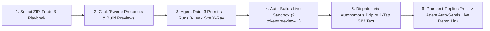

# TIBERIUS META-RECON™ — STANDARD OPERATING PROCEDURE (SOP), USE CASES & FUTURE ROADMAP

**System:** Tiberius Meta-Recon™ (Module 04 — Autonomous Lead-Gen & Outbound Engine for Tiberius AI)  
**Live Portal:** https://www.tiberius.ai/recon/command#meta-recon-module  
**API Endpoint:** `/api/recon/meta-outreach` · **Inbound Webhook:** `/api/webhooks/resend`

---

## PART 1: STEP-BY-STEP DAILY SOP (THE 5-MINUTE ROUTINE)

> [!IMPORTANT]
> **Golden Rule of Meta-Recon:** Never pitch "AI software" in Touch 1. Always lead with either **a real commercial permit they can bid on today** (Playbook A/C) or **a specific revenue leak on their mobile website** (Playbook B), with **zero links in Touch 1** so 100% of emails land in the Primary Inbox.

### Step 1: Open the Meta-Recon Command Deck
1. Go to **https://www.tiberius.ai/recon/command#meta-recon-module** (or scroll to **Module 04** at the bottom of the Territory Command page).
2. Check the top telemetry bar to see your active pipeline metrics:
   - **Prospects Gathered** & **HOT/WARM Lead Score**
   - **Monthly Leak Found** (cumulative monthly revenue leak identified across your prospect list)
   - **Anti-AI Copy Gate** (must read `100% PASS`)
   - **Touches Sent / Auto-Demos Delivered**

### Step 2: Choose Your Target Filter & Outbound Playbook
Use the 3 dropdowns in the control bar to aim the scout:
1. **Target Territory ZIP:** Pick a specific corridor (`78130` New Braunfels, `78701` Austin Metro, `78258` San Antonio North) or `All Corridor ZIPs`.
2. **Target Contractor Vertical:** Pick `Commercial Concrete`, `Roofing / Exteriors`, `Electrical / HVAC`, `Custom Pools & Perimeter`, `B2B / Commercial Services`, or `All Trades`.
3. **Outbound Agent Playbook:**
   - **Playbook C • Permit Bait + 3-Leak Bundle (Recommended Default):** Baits the contractor with a real commercial permit in Touch 1, then introduces their website's conversion leak + the `$200/mo` Smart Site equity credit in Touch 2.
   - **Playbook A • Trojan Horse Live Permit Bait:** Pure permit-first hook for established commercial subcontractors.
   - **Playbook B • 3-Leak Website CRO Teardown:** Pure website-leak + missed-call revenue math hook for local residential/light-commercial shops.

### Step 3: Pull Real Live Contractors or Import Your Own CSV
You now have **three ways** to load real local contractor leads into Module 04:
1. **Click `🌐 Pull Real Live Contractors` (Zero-API State Open Data + Web Crawl):**
   - Queries active licensed & registered Texas businesses in real time from **Texas TDLR (`data.texas.gov/resource/7358-krk7.json`)**, **Texas Comptroller Active Franchise Taxpayers (`9cir-efmm`)**, and **Austin Build+Connect Open Permits (`3syk-w9eu`)** for any 5-digit Texas ZIP code.
   - Automatically probes each company's live website & DNS MX records, scrapes public emails & phones, inspects their live homepage DOM for the **3-Leak Website X-Ray**, pairs **3 real commercial permits** in their ZIP, and provisions a working **Preview Briefing** (`/recon/briefing?token=preview-...`) + **Loom Watch Link** (`/recon/watch?token=preview-...`).
2. **Click `➕ Add Prospect / Import CSV`:**
   - **Single Real Contractor Form:** Enter a company name + ZIP + trade (leave email or website blank to have Recon auto-crawl their live domain).
   - **Bulk CSV / Google Maps Paste:** Paste CSV/TSV rows or upload a `.csv` export from Google Maps / Outscraper / spreadsheets to enrich up to 25 contractors at once.
3. **Click `🛰️ Sweep Saved / Sandbox`:**
   - Refreshes your saved custom contractors alongside the safe sandbox directory (`feedbackdaisy+*@gmail.com`) for dry-run testing.

### Step 4: Review Drafts & Dispatch Outbound (3 Ways to Send)
On each prospect card, you can click **`Touch 1`**, **`Touch 2`**, **`Touch 3`**, or **`Touch 4`** to preview the entire 14-day sequence:
- **Option A — Full Autopilot Batch (`⚡ Run Autonomous Drip Batch`):** Click the green button in the top-right header of Module 04. It automatically dispatches Touch 1 via Resend (`recon@send.tiberius.ai`) to all `HOT`/`WARM` prospects that passed the Anti-AI Copy Gate, spaced with 4–7 minute jitter and thread-locked `Reply-To` headers (`reply+tiberius-hq+<prospectId>@inbound.tiberius.ai`).
- **Option B — Single 1-Tap Email (`✓ Send Touch 1 Email`):** Sends the active touch to that specific contractor immediately.
- **Option C — Personal Cell Blue/Green Bubble (`📲 Native SIM Text`):** On your phone (or Mac paired with iPhone), tap **`📲 Native SIM Text`**. It opens your native Messages app with the prospect's phone number and pre-written text ready to tap Send—**0% Twilio A2P carrier risk and $0 messaging fees**.

### Step 5: Let the Autonomous Reply Agent Deliver the Demo
When a prospect replies to your email (e.g., *"Yeah, send over the permit packet"* or replies *"1"* to the Day-14 breakup email):
1. **`/api/webhooks/resend` Catches the Reply:** Strips the quoted email chain and classifies the intent (`POSITIVE_SEND_DEMO`, `DEFER_60_DAYS`, `UNSUBSCRIBE_CLOSE`, or `QUESTION_NEEDS_REVIEW`).
2. **Halts Cold Follow-Ups Automatically:** Immediately marks Touches 2, 3, and 4 as `HALTED_ON_REPLY` so the prospect never receives another automated follow-up.
3. **Auto-Sends Their Live Preview Link:** If the reply is positive, the agent immediately emails them their personalized Preview Briefing link (`/recon/briefing?token=preview-...`) + their 3-Leak Website Breakdown.
4. **Texts Your Cell Phone:** Fires a `🔥 HOT RECON REPLY` SMS to your phone via Master Twilio A2P so you can jump in and close.
   - *(Tip: You can test this whole flow anytime by clicking **`⚡ Simulate "Yes, send it!" Reply`** on any card in Module 04.)*

### Step 6: Close the Deal on a 10-Minute Call
1. Click **`Open Live Preview Briefing →`** on the prospect's card so you are looking at the exact same personalized briefing screen they just received.
2. Have them tap **`[ ✓ Approve & Send ]`** on Card #1 so they feel the 90-second morning coffee workflow firsthand.
3. Show them the **6 Locked Overflow Permits** below Card #3 and let them know **`1 of 2 Territory Slots`** in their ZIP is still open, with **`$200/mo`** of their subscription credited toward 100% ownership of a Tiberius Smart Site.

---

## PART 2: HIGH-CONVERTING USE CASES

| Use Case | Target Prospect Profile | Recommended Playbook | Why It Converts |
| :--- | :--- | :--- | :--- |
| **1. Filling Empty Territory ZIPs** | Commercial Concrete, Roofing, & MEP/HVAC subs in a new ZIP (`78130`, `78701`, `78258`) | **Playbook A or C** (Permit Bait First) | Contractors ignore software pitches, but no estimator turns down a free $800K permit packet with the GC PM's direct cell number. |
| **2. "5-Star Reputation, Weak Website" Rescue** | Local contractors with `40–150+` Google reviews (`4.7★+`) who are Facebook-only, have no site, or have a 7-field static form | **Playbook B** (3-Leak Website Teardown) | They already have word-of-mouth demand; showing them in plain math that their mobile form leaks `$12K–$18K/mo` makes a Smart Site a no-brainer. |
| **3. The "Slot #2 Scarcity" Domino Play** | The top 5 competing shops in a ZIP code right after you sign Client #1 in that trade | **Playbook C → Touch 3 Angle** | Telling a roofer or concrete sub *"1 of the 2 slots in 78130 just locked; want to see the live queue before your competitor takes Slot #2?"* creates real, ethical urgency. |
| **4. High-Ticket Custom Outdoor & Residential** | Custom Pool builders, Ornamental Iron/Fence shops, & Custom Remodelers | **Playbook C** | Pairs high-valuation residential CAD additions with an interactive ballpark estimator on their website to filter out tire-kickers. |
| **5. B2B Professional Services Expansion** | Commercial Insurance Brokers (Builder's Risk), CPAs (Cost-Seg / TI buildouts), & Commercial Cleaning/Striping | **Playbook A** (Trigger Bait) | Every commercial permit over $250K requires a Builder's Risk policy, tax depreciation structuring, and a post-construction final clean. |

---

## PART 3: FUTURE IDEAS & NEXT-LEVEL AUTONOMOUS UPGRADES

> [!TIP]
> Because `Tiberius Meta-Recon™` shares the exact same worker and webhook backbone as `Tiberius Recon`, each of the upgrades below plugs directly into [`workers/meta-recon-orchestrator.js`](file:///c:/Users/monet/OneDrive/Documents/A%20%20%20%20%20%20%20A%20%20%20%20%20%20%20A%20%20%20%20%20%20%20CODEX-WORK/A%20%20%20%20%20%20%20A%20%20%20%20%20%20%20A%20%20%20%20%20%20TIBERIUS%20SMART%20SITES/Tiberius%20Recon/workers/meta-recon-orchestrator.js).

### 1. Auto-Generated Smart Site Live Previews (`?preview-site=<slug>`)
Right now, Meta-Recon auto-provisions a working **Recon Briefing Sandbox** (`?token=preview-...`) for every prospect. Next, we can have the 2:00 AM sweep automatically inject the prospect's real company name, phone number, city, trade, and top Google reviews into our **Tiberius Smart Site Foundation** template—so when they reply *"Yes"*, they receive **both** their live 7:00 AM Permit Queue **and** a live, clickable preview of their new website.

### 2. ✅ LIVE — Real-Time "Prospect Is Looking at Their Preview Right Now" SMS Radar
Active inside `briefing.js`, `/api/recon/approve`, `/api/recon/watch`, and `/api/recon/meta-outreach` (`action: 'track_preview_event'`). Whenever a prospect opens their `preview-...` Briefing, clicks Play on their Loom Walkthrough, or taps `[ ✓ Approve & Send ]` on a sample card (with `&viewer=admin` bypassed and a 15-minute anti-spam cooldown per category), your phone receives an instant Master Twilio text with a 1-tap `tel:` call link, and the Live Radar Strip in Module 04 lights up.

### 3. Autonomous 45-Second Video Teardown Generator (Playwright + Voiceover)
Combine our `autonomous-site-reviewer` Playwright recorder with our existing voiceover pipeline (`voiceovers/`):
- At 3:00 AM, a headless browser records a 45-second split-screen MP4 showing the prospect's current mobile site next to their pre-built Tiberius Smart Site + 7:00 AM Permit Queue, paired with an AI voiceover citing their exact company name and permit address.

### 4. ✅ LIVE — Automated TDLR, TX Comptroller & Municipal Contractor Feed + CSV Intake
`workers/scrapers/tiberius-prospect-scout.js` is now connected directly to **Texas TDLR (`7358-krk7`)**, **Texas Comptroller Active Franchise Taxpayers (`9cir-efmm`)**, **Austin Open Permits (`3syk-w9eu`)**, and a live DNS MX + homepage/contact crawler—plus Module 04 includes single-contractor and bulk `.csv` intake (`action: 'add_prospect'` & `action: 'import_csv'`).

### 5. Multi-Inbox Sending Pool & Warmup Router
Add round-robin sender rotation in `dispatchViaResendEmail` across 3–5 secondary outreach domains (e.g., `billy@send.tiberius.ai`, `scout@try-tiberius.ai`, `permits@tiberius-recon.com`), capped at 35 cold Touch-1 emails per inbox per day. This lets you scale autonomous daily prospecting across Austin, San Antonio, Dallas, and Houston while keeping domain reputation pristine.
